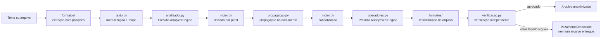
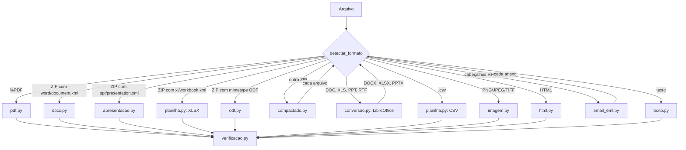
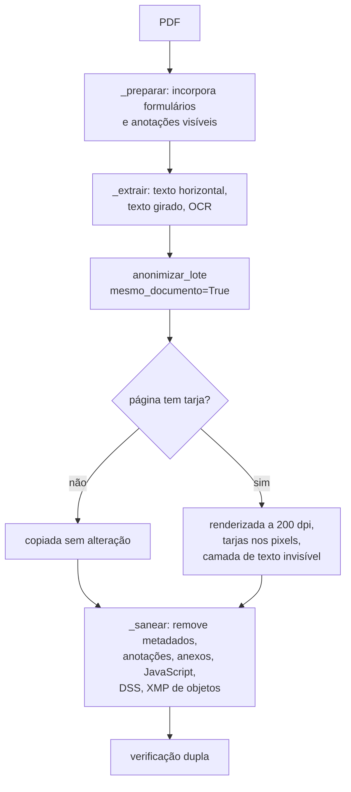

# Arquitetura

Este documento descreve a organização interna do Themis LGPD: o fluxo de processamento de um texto,
o tratamento de cada formato de arquivo, o mapa de módulos e os pontos de extensão. Para uma visão
sem detalhes de implementação, consulte [COMO_FUNCIONA.md](COMO_FUNCIONA.md). As decisões de projeto
estão registradas em [adr/](adr/README.md).

## Visão geral

O Themis é uma camada sobre o [Microsoft Presidio](https://github.com/data-privacy-stack/presidio).
O Presidio fornece o motor de análise (`AnalyzerEngine`, `RecognizerRegistry`, `SpacyNlpEngine`,
`LemmaContextAwareEnhancer`) e o motor de substituição (`AnonymizerEngine`). O Themis acrescenta:

- reconhecedores para dados brasileiros, escritos como `EntityRecognizer` do Presidio;
- normalização do texto com mapa de posições até o original;
- política de decisão por perfil (LGPD × LAI), com falha fechada para identificadores;
- propagação de valores tarjados para todo o documento;
- resolução de sobreposições sem fragmentos visíveis;
- leitura e reconstrução de arquivos com remoção efetiva do conteúdo tarjado;
- verificação independente do arquivo gerado.



## Fluxo de um texto

O ponto de entrada é a classe `Anonimizador` (`src/themis_lgpd/motor.py`). Os métodos
`analisar_lote` e `anonimizar_lote` processam vários textos de uma vez; `analisar` e `anonimizar` são
atalhos para um único texto.

### 1. Normalização (`texto.py`)

A detecção ocorre sobre uma cópia normalizada do texto, nunca sobre o original. A função
`normalizar` produz um `TextoNormalizado` com o texto de detecção e, para cada caractere, o intervalo
correspondente no original. As transformações são:

| Transformação | Exemplo | Motivo |
|---|---|---|
| Correção de codificação (ftfy), somente com sinais claros de mojibake | `João` → `João` | Texto exportado com codificação errada |
| Remoção de caracteres invisíveis e de controle | espaço de largura zero, marcas bidirecionais | Evasão por caracteres invisíveis |
| Unicode NFKC e substituição de homóglifos | letras cirílicas idênticas às latinas | Evasão por homóglifos |
| Espaços especiais convertidos em espaço comum | espaço não separável | Consistência dos padrões |
| Hifenização de fim de linha desfeita | `Apa-\nrecida` → `Aparecida` | Nomes quebrados entre linhas |
| Correção de letras confundidas pelo OCR em sequências numéricas | `1Z3.456.789-OO` → `123.456.789-00` | Documentos digitalizados |

O texto de saída é sempre construído a partir do original (com a codificação corrigida, quando for o
caso). Fora dos trechos tarjados, o documento permanece idêntico.

### 2. Detecção (`analisador.py`)

`obter_analisador(modelo)` cria, uma única vez por processo e por modelo, um `AnalyzerEngine` do
Presidio configurado para o idioma `pt`:

- **Motor de linguagem:** `MotorSpacyThemis`, uma especialização do `SpacyNlpEngine` que carrega o
  modelo `pt_core_news_lg` sem o analisador sintático e nunca o baixa automaticamente. Com
  `usar_ner=False`, um modelo vazio com lematizador mínimo é usado.
- **Registro de reconhecedores:** os reconhecedores brasileiros (`reconhecedores_brasileiros()`) e os
  reconhecedores predefinidos do Presidio reconfigurados para os tipos do Themis:

  | Reconhecedor | Tipo produzido | Observação |
  |---|---|---|
  | `BR_Documentos` | CPF, CNPJ, RG, CNH, PIS, título, CNS, passaporte, CTPS, certidão, matrícula, registro profissional, data de nascimento, documento | Dígito verificador quando aplicável |
  | `BR_Email` | EMAIL | Inclui formas ofuscadas ("arroba", "ponto") |
  | `BR_Telefones_Perfis` | TELEFONE, PERFIL_REDE_SOCIAL | |
  | `BR_URL` | URL, PERFIL_REDE_SOCIAL | Sem consulta a listas públicas de domínios |
  | `BR_Enderecos` | ENDERECO, CEP | Inclui o endereçamento do Distrito Federal |
  | `BR_Localidades` | LOCALIDADE, ENDERECO | Regiões administrativas do DF |
  | `BR_Financeiro` | CONTA_BANCARIA, CARTAO, CHAVE_PIX | |
  | `BR_Veiculos` | PLACA, RENAVAM | |
  | `BR_Processos` | PROCESSO_JUDICIAL, PROCESSO_ADMINISTRATIVO, PROTOCOLO | Módulo 97 no padrão CNJ |
  | `BR_Nomes_Lista`, `BR_Nomes_Gatilho`, `BR_Nomes_Modelo` | NOME | Lista de nomes, gatilhos de contexto e entidades do spaCy |
  | `BR_Saude`, `BR_Sensiveis`, `BR_Intimidade`, `BR_Menores`, `BR_Quase_Identificadores` | tipos sensíveis e quase-identificadores | |
  | `Presidio_Telefone_BR` (`PhoneRecognizer`) | TELEFONE | Biblioteca phonenumbers, região BR |
  | `Presidio_IP` (`IpRecognizer`) | IP | |
  | `Presidio_Cartao` (`CreditCardRecognizer`) | CARTAO | Algoritmo de Luhn |
  | `Presidio_IBAN` (`IbanRecognizer`) | CONTA_BANCARIA | |
  | `Presidio_Cripto` (`CryptoRecognizer`) | CARTEIRA_CRIPTO | |

  Os reconhecedores de e-mail e URL do Presidio não são registrados, pois consultam pela internet a
  lista pública de sufixos de domínio (ver [ADR 0005](adr/0005-operacao-offline.md)). O
  `SpacyRecognizer` padrão é substituído por `BR_Nomes_Modelo`, que lê as entidades já extraídas pelo
  `SpacyNlpEngine` e aplica filtros específicos (títulos, texto em caixa alta, nomes de normas, lugares
  e instituições).
- **Reforço por contexto:** `LemmaContextAwareEnhancer` (seis palavras antes e duas depois), com as
  listas de contexto definidas em `analisador.CONTEXTO`. Reconhecedores do Themis que já consideraram o
  contexto marcam o resultado para que o reforço não seja aplicado duas vezes.

`analisar_textos` divide textos longos em blocos de até 100 mil caracteres com sobreposição de 2 mil
(`nomes.partes`), processa todos os blocos do lote com `nlp.pipe` e chama `AnalyzerEngine.analyze`
para cada bloco, com o limiar de confiança do perfil e a explicação da decisão
(`return_decision_process=True`). Cada resultado é convertido em uma `Deteccao` com tipo, posição,
confiança, origem (reconhecedor e palavra de contexto) e camada.

**Camadas.** Cada detecção pertence a uma camada, usada pela política de decisão:

| Camada | Significado | Exemplo |
|---|---|---|
| `estrutural` | Formato próprio do dado, em geral com dígito verificador | CPF, CEP, placa |
| `contextual` | Expressão que descreve a situação de uma pessoa | "diagnosticado com…" |
| `semantica` | Termo isolado de categoria sensível | "asma", "católico" |
| `ner` | Entidade nomeada do modelo de linguagem | "Maria Souza" |

### 3. Decisão por perfil (`motor.py`, `perfis.py`)

`Anonimizador._decidir` aplica o perfil a cada detecção, na ordem:

1. Detecções com confiança abaixo de `score_alerta` são descartadas.
2. Detecções contidas em termo da lista de permissão recebem `manter`.
3. Categorias com regra `manter` no perfil são descartadas.
4. Detecções com confiança abaixo de `score_minimo`:
   - em categorias identificadoras com regra `tarjar`, são **tarjadas por precaução** (falha fechada);
   - nas demais, viram alerta.
5. Regra `vinculado` (dados sensíveis): achados estruturais e contextuais são tarjados; termos
   semânticos isolados são tarjados apenas quando a frase se refere a uma pessoa determinada (marcador
   de primeira pessoa, possessivo, papel como "a requerente", ou identificador pessoal na mesma frase);
   caso contrário, viram alerta. Tipos em `tarjar_sensivel_sempre` (perfil `saude`) são sempre tarjados.
6. Com `preservar_agentes_publicos`, nomes precedidos ou seguidos de cargo público recebem `manter`.

As regras de cada perfil estão em [TIPOS_DE_DADOS.md](TIPOS_DE_DADOS.md#perfis).

### 4. Propagação (`propagacao.py`)

Um reconhecedor pode identificar um dado somente onde há contexto (o CPF após a palavra "CPF", o nome
após "Requerente:"). `Anonimizador._propagar` procura todas as demais ocorrências dos valores tarjados
e as tarja também:

- a busca usa uma representação compacta dos textos (apenas letras e dígitos, sem acentos e em
  minúsculas), indiferente a pontuação e espaçamento (`529.982.247-25` × `52998224725`);
- toda ocorrência precisa começar e terminar em limite de palavra no original;
- partes de nomes com quatro letras ou mais, iniciadas por maiúscula e que não sejam palavras comuns,
  também são propagadas ("Sra. Fagundes" após "Ana Beatriz Fagundes");
- nomes de pessoa não são propagados para dentro de nomes de lugares, instituições e normas
  ("São Paulo", "Rua Paulo Freire", "Lei Maria da Penha");
- ocorrências protegidas pela lista de permissão, por entidades `manter` ou por nomes de lugares e
  organizações não tarjados são preservadas.

Com `mesmo_documento=True`, todos os textos do lote são tratados como partes de um único documento:
um valor tarjado em uma página, célula ou parágrafo é tarjado em todos. Todos os formatos de arquivo
usam esse modo. Ver [ADR 0007](adr/0007-propagacao-no-documento.md).

### 5. Consolidação (`motor.py`)

`Anonimizador._consolidar` normaliza a lista de entidades de cada texto:

1. **Expansão até o limite do token.** Quando um reconhecedor delimita apenas parte de uma palavra ou
   número, a tarja é estendida até a borda. Números ligados por `.`, `-` ou `/` são tratados como um
   único token. Evita fragmentos como `CNH 0[TELEFONE]`.
2. **Eliminação de duplicatas** e fusão de entidades do mesmo tipo que se sobrepõem ou se tocam.
3. **Prioridade.** Entre entidades sobrepostas, prevalece a de maior prioridade do tipo
   (`catalogo.TIPOS`); entidades contidas em outra de prioridade igual ou maior saem do relatório,
   mas a área coberta pelas tarjas nunca diminui.

Na substituição, cada caractere tarjado pertence à entidade de maior prioridade que o cobre. Ver
[ADR 0003](adr/0003-prioridade-e-expansao-nas-sobreposicoes.md).

### 6. Substituição (`operadores.py`)

`aplicar_com_presidio` aplica as substituições ao texto original com o `AnonymizerEngine` do Presidio:
operador `replace` para os modos de valor fixo (`etiqueta`, `tarja`) e operador `custom` para os modos
que dependem do valor (`mascara`, `pseudonimo`, `hmac`). Os substitutos são calculados na ordem do
texto, para que "Pessoa 1" seja a primeira pessoa citada. O resultado registra, para cada troca, as
posições no original e na saída, o trecho e o substituto (`Resultado.substituicoes`), base do cofre
de reversão.

### Objetos de resultado

- `Entidade`: posição no original, tipo, valor, confiança, origem, camada, validação por dígito
  verificador, ação (`tarjar`, `alertar`, `manter`), motivo e posição na saída.
- `Resultado`: texto original e anonimizado, entidades, perfil, modo, avisos e registro de
  substituições. `para_dict()` serializa sem valores pessoais, salvo pedido explícito.
- `ResultadoArquivo` (`formatos`): bytes do arquivo gerado, formato, nome, resultados por trecho e
  avisos ao usuário.

## Fluxo por formato

Todos os formatos seguem o mesmo esquema: extrair o texto com as posições de origem, analisar todas
as partes com `anonimizar_lote(..., mesmo_documento=True)`, gravar as substituições nas posições de
origem, reconstruir o arquivo e verificar o resultado. O formato é detectado pelo conteúdo
(`detectar_formato`), não pela extensão.



| Formato | Módulo | Extração | Reconstrução | Verificação |
|---|---|---|---|---|
| PDF | `formatos/pdf.py` | pdfplumber (caixa por caractere), texto girado por coluna, OCR quando necessário | Rasterização das páginas com tarja (pypdfium2 + Pillow), camada de texto invisível (ReportLab), reescrita e saneamento (pikepdf) | Texto por pdfplumber e PDFium, cadeias de todos os objetos e fluxos de metadados |
| DOCX | `formatos/docx.py`, `xml_office.py`, `pacote.py` | Todas as partes XML do pacote, em fluxo por parte | Edição do XML nas posições originais; pacote regravado sem partes removidas | Texto e atributos de todas as partes XML e de relacionamento |
| XLSX | `formatos/planilha.py` | openpyxl (células e objetos da pasta de trabalho) e XML de gráficos e desenhos | openpyxl; pós-processamento de gráficos e desenhos | Idem DOCX |
| CSV | `formatos/planilha.py` | Módulo `csv`, delimitador detectado | Mesmo delimitador, UTF-8 com BOM | Texto gerado |
| TXT | `formatos/texto.py` | UTF-8 ou Windows-1252 | UTF-8 | Texto gerado |
| PPTX | `formatos/apresentacao.py` (núcleo de `docx.py`) | Idem DOCX | Idem DOCX | Idem DOCX |
| ODT, ODS | `formatos/odf.py` | Partes XML do pacote ODF, em fluxo por parte, células e fórmulas | Edição do XML; pacote regravado com `mimetype` primeiro e manifesto refeito | Idem DOCX |
| HTML | `formatos/html.py` | lxml.html: fluxo de texto, atributos, URLs, imagens `data:` | Árvore regravada em UTF-8 | Texto e atributos da página gerada |
| EML | `formatos/email_eml.py` | Módulo `email` (política moderna): cabeçalhos, partes, anexos | Mensagem nova; anexos pelo próprio formato | Cabeçalhos, partes de texto e HTML, nomes de anexos |
| ZIP | `formatos/compactado.py` | Cada entrada pelo próprio formato; nomes analisados | ZIP novo com manifesto | Nomes e manifesto; cada arquivo pelo seu formato |
| DOC, XLS, PPT, RTF | `formatos/conversao.py` | Conversão pelo LibreOffice (`--headless`, perfil temporário) | Formato de destino | Formato de destino |
| PNG, JPEG, TIFF | `formatos/imagem.py` | OCR (Tesseract, pela entrada padrão, ou RapidOCR); sem OCR, `FalhaOCR` | Tarja nos pixels, PNG novo (TIFF: TIFF novo, mesmas páginas) | Novo OCR da imagem gerada |

O detalhamento das proteções de cada formato está em
[SEGURANCA_E_PRIVACIDADE.md](SEGURANCA_E_PRIVACIDADE.md#proteções-por-formato).

### PDF



Constantes relevantes: `DPI = 200`, `MAX_PIXELS = 40_000_000` por página,
`LIMIAR_AREA_IMAGEM = 0.15` (fração da página coberta por imagens que aciona OCR),
`LIMIAR_TEXTO_ILEGIVEL = 0.10` (fração de caracteres sem mapeamento Unicode que aciona OCR).
Quando uma página exige OCR e nenhum mecanismo está disponível, ou o OCR falha, o processamento é
interrompido com `FalhaOCR`; somente com `ocr=False` a página é mantida sem análise, com aviso.

### Pacotes Office

`formatos/pacote.py` implementa a leitura e a gravação de pacotes OPC (o contêiner ZIP do DOCX e do
XLSX): rejeição de entradas duplicadas e criptografadas, interpretação de XML sem DTD, sem resolução
de entidades e sem comentários, resolução de relacionamentos e cálculo das partes alcançáveis a partir
da raiz. `formatos/xml_office.py` converte cada parte XML em unidades de análise:

| Unidade | Conteúdo |
|---|---|
| Fluxo de texto | Todos os parágrafos da parte (`w:t`, `a:t`, `m:t`), com parágrafos, tabulações e quebras convertidos em separadores |
| Instruções de campo | `w:instrText`, agrupadas por parágrafo |
| Valores isolados | Valores em cache de gráficos (`c:v`) |
| Atributos de texto livre | Texto alternativo e nome de imagens, dicas de hiperlinks, rótulos de controles e campos de formulário, texto de WordArt |
| Texto residual | Qualquer outro texto de qualquer elemento, analisado isoladamente |

A unidade de texto residual garante que nenhum texto deixe de ser analisado por estar em um elemento
não previsto.

## Mapa de módulos

```
src/themis_lgpd/
├── __init__.py          API pública: Anonimizador, Entidade, Resultado, anonimizar, PERFIS, MODOS
├── motor.py             Orquestração: decisão, propagação, consolidação, substituição
├── analisador.py        AnalyzerEngine do Presidio, adaptadores e reconhecedores registrados
├── texto.py             Normalização com mapa de posições; dobra de caixa e acentos
├── propagacao.py        Busca de outras ocorrências de valores tarjados
├── perfis.py            Perfis e regras por categoria
├── catalogo.py          Tipos de dado, categorias, etiquetas, prioridades e base legal
├── operadores.py        Modos de substituição e integração com o AnonymizerEngine
├── validadores.py       Dígitos verificadores e geradores de documentos fictícios
├── relatorio.py         Relatório de tarjamento (JSON, CSV, XLSX) e nota de tarjamento
├── cofre.py             Cofre cifrado para reverter pseudonimização
├── config.py            Configuração do serviço por variáveis THEMIS_*
├── configuracao.py      Configuração do órgão (themis.toml): perfis, listas, cargos, tipos e reconhecedores
├── lote.py              Lotes: coleta de pastas, paralelismo, retomada e manifesto de custódia
├── cli.py               Linha de comando (themis)
├── reconhecedores/
│   ├── base.py          Padrao, Deteccao, ReconhecedorPadroes, camadas
│   ├── documentos.py    Documentos pessoais
│   ├── contatos.py      E-mail, telefone, perfis, URL
│   ├── localizacao.py   Endereços, CEP, municípios do IBGE e regiões administrativas do DF
│   ├── financeiro.py    Dados bancários, cartões, PIX, veículos, processos e protocolos
│   ├── nomes.py         Nomes: lista, gatilhos, filtro das entidades do spaCy, carregamento do modelo
│   └── sensiveis.py     Saúde, convicções, intimidade, menores, quase-identificadores
├── formatos/
│   ├── __init__.py      Detecção de formato, limites, anonimizar_arquivo, exceções
│   ├── pdf.py           PDF
│   ├── pdfa.py          Camada de texto Unicode, idioma e PDF/A-2b do PDF gerado
│   ├── docx.py          Política de remoção e análise do Word; núcleo comum aos pacotes OOXML
│   ├── apresentacao.py  PowerPoint (PPTX)
│   ├── planilha.py      XLSX e CSV
│   ├── odf.py           ODT e ODS
│   ├── html.py          Páginas HTML (documentos do SEI)
│   ├── email_eml.py     Mensagens de e-mail, com anexos
│   ├── compactado.py    ZIP (exportação de processos), com manifesto
│   ├── conversao.py     DOC, XLS, PPT e RTF pelo LibreOffice
│   ├── regioes.py       Tarja manual por região em PDFs e imagens
│   ├── imagem.py        PNG, JPEG e TIFF; imagens incorporadas
│   ├── midia.py         Remoção de metadados de imagens sem recompressão
│   ├── qr.py            Localização e leitura de QR codes (BR Code do PIX)
│   ├── metarquivo.py    Texto de metarquivos EMF e WMF
│   ├── texto.py         TXT
│   ├── ocr.py           Tesseract e RapidOCR
│   ├── pacote.py        Contêiner OPC (ZIP + relacionamentos)
│   ├── xml_office.py    Unidades de análise de partes XML do Office
│   └── verificacao.py   Verificação independente do arquivo gerado
├── integracoes/
│   ├── presidio.py      Reexporta os reconhecedores para uso em outro AnalyzerEngine
│   └── gliner.py        Reconhecedor GLiNER opcional
├── api/
│   ├── app.py           API HTTP (FastAPI): rotas, proteções e tarefas assíncronas
│   └── trabalho.py      Análises executadas em thread ou em processo de trabalho
├── ui/                  Interface web (Streamlit) e realce seguro de HTML
└── dados/               Prenomes (inclusive do Censo 2010), sobrenomes, nomes ambíguos, municípios e medicamentos
```

## Concorrência e desempenho

- O `AnalyzerEngine` e o modelo spaCy são carregados uma vez por processo e por modelo
  (`functools.lru_cache`) e compartilhados entre instâncias de `Anonimizador`.
- O processamento do modelo de linguagem (`nlp_engine.process_batch`) é serializado por uma trava
  global (`_TRAVA_NLP`), pois o mesmo objeto spaCy atende a interface e a API em várias threads. A
  etapa de reconhecedores (`AnalyzerEngine.analyze`) ocorre fora da trava.
- Cada `Anonimizador` tem o próprio `Substituidor`, cujo estado (contadores de pseudônimos) é
  reiniciado a cada chamada de `anonimizar_lote`, exceto com `continuar=True` — usado quando partes
  de um mesmo arquivo são processadas em etapas, como as células e depois os gráficos de uma
  planilha. Uma instância não deve ser compartilhada entre threads quando o modo depende de estado
  (`pseudonimo`).
- A API limita a concorrência com um semáforo (`THEMIS_CONCORRENCIA`) e o tempo de cada requisição
  (`THEMIS_TIMEOUT_S`).

No benchmark esic-ner, o tempo médio fica entre 17 e 22 ms por pedido em CPU comum
([BENCHMARKS.md](BENCHMARKS.md)). Em PDFs, a rasterização e o OCR dominam o tempo de processamento.

## Extensibilidade

### Reconhecedores adicionais

`Anonimizador(reconhecedores_extras=[...])` aceita instâncias de `EntityRecognizer` do Presidio ou
qualquer objeto com o método `detectar(texto) -> list[Deteccao]`. Os reconhecedores extras entram como
reconhecedores *ad hoc* do Presidio, sem alterar o `AnalyzerEngine` compartilhado.

```python
from presidio_analyzer import Pattern, PatternRecognizer
from themis_lgpd import Anonimizador

contrato = PatternRecognizer(supported_entity="DOCUMENTO", supported_language="pt",
                             patterns=[Pattern("contrato interno", r"\bCT-\d{6}\b", 0.9)])
anon = Anonimizador(reconhecedores_extras=[contrato])
```

O tipo produzido deve existir em `catalogo.TIPOS` para herdar categoria, etiqueta, prioridade e base
legal; tipos desconhecidos são tratados como `DADO_PESSOAL` com prioridade 50.

### Modelo GLiNER (opcional)

`themis_lgpd.integracoes.gliner.reconhecedor_gliner()` devolve um `GLiNERRecognizer` do Presidio
configurado para os tipos do Themis. Requer `pip install "themis-lgpd[ml]"` (PyTorch) e baixa o modelo
do Hugging Face na primeira execução; depois disso, executa localmente. É a única funcionalidade que
acessa a internet, e somente quando usada explicitamente.

```python
from themis_lgpd import Anonimizador
from themis_lgpd.integracoes.gliner import reconhecedor_gliner

anon = Anonimizador(reconhecedores_extras=[reconhecedor_gliner()])
```

### Reconhecedores brasileiros em outro AnalyzerEngine

Os reconhecedores do Themis são `EntityRecognizer` comuns e podem ser registrados em qualquer
instalação do Presidio configurada para português:

```python
from themis_lgpd.integracoes.presidio import reconhecedores_brasileiros

for reconhecedor in reconhecedores_brasileiros(com_modelo=False):
    engine.registry.add_recognizer(reconhecedor)
engine.analyze("CPF 529.982.247-25", language="pt")
```

Com `com_modelo=True`, inclui `BR_Nomes_Modelo`, que depende das entidades produzidas pelo
`SpacyNlpEngine` com o mapeamento `PER → PERSON`.

### Perfis personalizados

Qualquer instância de `themis_lgpd.perfis.Perfil` pode ser passada ao `Anonimizador`:

```python
from themis_lgpd import Anonimizador, Perfil, PERFIS

base = PERFIS["lai"]
perfil = Perfil("ouvidoria", "Ouvidoria", "LAI com tarja de localidades",
                {**base.regras, "LOCALIDADE": "tarjar"})
anon = Anonimizador(perfil)
```
