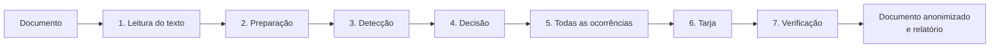

# Como o Themis decide o que tarjar

Este documento explica, sem detalhes de implementação, como o Themis LGPD encontra dados pessoais,
decide o que tarjar e produz o arquivo anonimizado. Destina-se a quem revisa documentos, a gestores e
a áreas jurídicas. A descrição técnica está em [ARQUITETURA.md](ARQUITETURA.md).

## Visão geral

## 1. Leitura do texto

O Themis lê o texto de cada formato junto com a posição de cada caractere: páginas de PDF (inclusive
texto girado nas margens, campos de formulário preenchidos e, por OCR, páginas digitalizadas),
parágrafos, tabelas e cabeçalhos de documentos Word, células e outros elementos de planilhas, e o texto
de imagens. Todas as partes de um arquivo são tratadas como um único documento.

## 2. Preparação

A detecção ocorre sobre uma cópia preparada do texto, para que truques de formatação não escondam
dados: caracteres invisíveis são removidos, letras de outros alfabetos idênticas às latinas são
convertidas, palavras hifenizadas no fim da linha são reunidas (inclusive em caixa alta e com `¬`),
números partidos depois do hífen são reunidos, campos de formulário em quadrícula (`M A R I A`) viram
palavras, rótulos colados ao valor (`Nome:FULANO`) ganham o espaço que falta e letras confundidas pelo
OCR dentro de números são corrigidas (`1Z3.456.789-OO` → `123.456.789-00`). O documento final só muda
nos trechos tarjados.

## 3. Detecção

| Mecanismo | Exemplos |
|---|---|
| Documentos com dígito verificador | CPF, CNPJ (inclusive alfanumérico), PIS/NIS, título de eleitor, Cartão SUS, CNH, processo judicial, cartão de pagamento |
| Padrões com palavra de contexto | RG, passaporte, CTPS, matrícula, OAB/CRM, data de nascimento, conta bancária, PIX, placa, RENAVAM, protocolos |
| Contato e localização | E-mail (inclusive formas como "joao arroba gmail ponto com"), telefone, perfil em rede social, IP, CEP, endereço (inclusive SQS, QNM, SHIS e demais endereços do DF) |
| Nomes | Modelo de linguagem em português, lista de nomes brasileiros e expressões como "meu nome é", "requerente:" e "Atenciosamente," |
| Tabelas e formulários | Em tabelas de pessoas (com coluna de nome ou de identificador pessoal), cada coluna é tipificada pelo cabeçalho — matrícula, registro profissional, data de nascimento, agência e conta, valor pago —, inclusive em colunas alinhadas por espaços, em arquivos CSV e em colunas extraídas uma depois da outra; nos formulários, o valor é ligado ao rótulo que está em outra linha |
| Dados sensíveis | Saúde (CID, diagnósticos, cerca de 150 condições), religião, opinião política, filiação sindical, vida sexual, dado genético ou biométrico, origem racial; violência e situação de risco; dados de crianças |

A detecção usa o Microsoft Presidio, com reconhecedores desenvolvidos para documentos brasileiros.

## 4. Decisão

Cada achado é tarjado, sinalizado para revisão (alerta) ou mantido, conforme o **perfil** escolhido:

| Categoria | `lai` (padrão) | `identificadores` | `saude` | `ouvidoria` | `educacao` | `maxima` |
|---|---|---|---|---|---|---|
| Nomes, documentos, contatos, endereços, dados financeiros, veículos, processos | tarja | tarja | tarja | tarja | tarja | tarja |
| Frase que descreve a situação de alguém ("diagnosticado com…", "vítima de violência doméstica") | tarja | alerta | tarja | tarja | tarja | tarja |
| Termo sensível isolado ("asma", "católico") | tarja se a frase se refere a uma pessoa; senão, alerta | alerta | tarja (saúde) | como `lai` | como `lai`; saúde, tarja | tarja |
| Dados de criança ou adolescente | como termo sensível | alerta | como termo sensível | tarja | tarja | tarja |
| CNPJ, endereços de internet | mantém | mantém | mantém | alerta (CNPJ), tarja (URL) | mantém | tarja |
| Município ou região administrativa isolada | alerta (tarja em "resido em…") | mantém | alerta | tarja | alerta | tarja |
| Quase-identificador ("atendente do guichê 4 na tarde de ontem") | alerta | alerta | alerta | tarja | tarja | tarja |

"A frase se refere a uma pessoa" significa que ela contém nome, documento, contato ou processo, ou
marcas como "eu", "minha filha", "tenho", "sofri", "a requerente". Assim, "a política de saúde mental
prevê atendimento para depressão" continua legível, enquanto "minha filha tem autismo" é tarjado.

Outras regras de decisão:

- **Na dúvida sobre um identificador, tarja.** Um CPF, telefone ou nome com confiança moderada é
  tarjado por precaução; um número com formato de CPF ao lado da palavra "CPF" é tarjado mesmo com
  dígito verificador errado. Expor um dado é irreversível; uma tarja a mais é corrigida na revisão.
- **Alertas não são tarjados:** aparecem na revisão e no relatório para decisão humana.
- **Listas:** termos da lista de permissão nunca são tarjados; termos da lista de bloqueio são sempre
  tarjados.
- **Agentes públicos:** com a opção correspondente, nomes acompanhados de cargo público no exercício da
  função são mantidos. A aplicação deve ser validada pela área jurídica.

## 5. Todas as ocorrências

Um nome pode ser reconhecido apenas onde aparece após "Requerente:" e reaparecer sozinho na
assinatura; um CPF pode estar no corpo do texto e repetido no rodapé, sem pontuação. O Themis procura
todas as ocorrências de cada dado tarjado no documento — inclusive referências parciais a nomes, como
"Sra. Fagundes" — e tarja todas. Nomes que fazem parte de nomes de lugares e instituições não são
afetados: tarjar a pessoa "Paulo" não altera "São Paulo".

## 6. Tarja

Cada trecho tarjado é substituído conforme o **modo** escolhido:

| Modo | Exemplo |
|---|---|
| `etiqueta` (padrão) | `[CPF]`, `[NOME]` |
| `tarja` | `████████` |
| `mascara` | `***.***.***-**` |
| `pseudonimo` | `Pessoa 1`, `[CPF 2]`, consistentes no documento |
| `hmac` | Código derivado do valor com chave secreta |

Nenhum pedaço do dado fica ao lado da tarja: se um reconhecedor delimitar apenas parte de um número,
a tarja é estendida até o fim dele.

Nos arquivos, o conteúdo tarjado é removido, não apenas encoberto:

- **PDF:** páginas com tarja são convertidas em imagem com as tarjas aplicadas e recebem uma camada de
  texto invisível só com o que não foi tarjado, para continuar pesquisável. Páginas sem tarja são
  mantidas. O arquivo é reescrito sem metadados, comentários, anexos e outros conteúdos ocultos.
- **Word:** o texto é alterado diretamente no documento; alterações controladas são aceitas (o texto
  excluído deixaria de estar visível, mas continuaria no arquivo), comentários e propriedades são
  removidos.
- **Planilhas:** células, fórmulas, nomes de abas e demais elementos são tratados; comentários e
  tabelas dinâmicas são removidos.
- **Imagens:** as regiões são cobertas e a imagem é gravada como arquivo novo, sem metadados.

O Themis informa, em avisos, tudo o que foi removido ou não pôde ser analisado (por exemplo, imagens
dentro de documentos Word).

## 7. Verificação

O arquivo gerado é lido novamente, por um caminho independente, e comparado com cada dado tarjado. Se
algum dado continuar legível em qualquer parte do arquivo — texto, metadados, propriedades —, o
arquivo não é entregue e o usuário recebe uma mensagem de erro.

## Relatórios

- **Relatório de tarjamento e nota de tarjamento:** o que foi tarjado, com base legal e justificativa,
  sem os valores originais. Podem acompanhar a resposta ao pedido de acesso, pois a restrição de acesso
  deve ser motivada (Enunciado CGU nº 4/2022).
- **Relatório interno com valores:** gerado somente sob pedido explícito, marcado como "contém dados
  pessoais"; não deve ser publicado.

## O que não é tarjado de propósito

Em atenção ao princípio da máxima divulgação da LAI, permanecem legíveis no perfil `lai`: números de
leis, editais, contratos, notas fiscais, empenhos e termos de parceria; nomes de instituições; CNPJ;
expressões genéricas de estado emocional ("estou chateada com a demora"); e termos sensíveis sem
vínculo com pessoa determinada, que aparecem como alerta.

## Anonimização e pseudonimização

Os modos `etiqueta`, `tarja` e `mascara` removem o dado. O modo `pseudonimo` preserva a
correspondência entre menções ("Pessoa 1"), o modo `hmac` permite cruzar registros sem revelar o valor
e o **cofre** permite reverter a substituição com senha. Na terminologia da ANPD, esses três casos são
**pseudonimização**: o dado continua sendo pessoal e deve ser protegido como tal.

## Revisão humana

O Themis apoia a decisão; não a substitui. Antes de publicar, revise os alertas, leia os avisos,
confira imagens, assinaturas e manuscritos e avalie se a combinação de informações mantidas (cargo,
lotação, datas, circunstâncias) permite identificar alguém. Ver
[GUIA_DE_USO.md](GUIA_DE_USO.md#boas-práticas-de-revisão).
