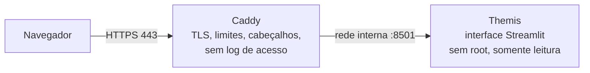

# Demonstração pública em servidor próprio

Este documento descreve a implantação de uma instância pública de demonstração do Themis LGPD em um
servidor próprio (VPS), com os arquivos do diretório `deploy/`. Para uso interno em uma organização, a
mesma configuração pode ser usada sem o modo de demonstração.

## Arquitetura



- **Caddy** (`deploy/Caddyfile`, `deploy/Dockerfile.caddy`): HTTPS com certificado automático, HSTS,
  limite de corpo de requisição, limite de requisições por IP (módulo `caddy-ratelimit`, fixado por
  commit), cabeçalhos de segurança e nenhum log de acesso.
- **Themis** (`Dockerfile`): interface web em contêiner sem root, sem capabilities, com sistema de
  arquivos somente leitura e temporários em memória; acessível apenas pela rede interna da composição.

## Requisitos

- Servidor Linux com 2 vCPU e 4 GB de RAM (o modelo de linguagem ocupa cerca de 1 GB por processo);
  Docker e Docker Compose.
- Domínio com registro A/AAAA apontando para o servidor; portas 80 e 443 liberadas.

## Implantação

```bash
git clone https://github.com/matheusteixeira-commits/themis-lgpd.git
cd themis-lgpd/deploy
cp .env.exemplo .env            # ajuste DOMINIO e EMAIL_ACME
docker compose up -d --build    # a primeira construção baixa o modelo de linguagem (cerca de 570 MB)
docker compose ps               # o serviço themis fica "healthy" em cerca de um minuto
```

O certificado TLS é emitido automaticamente pelo Caddy (Let's Encrypt) no primeiro acesso ao domínio.

### Variáveis (`deploy/.env`)

| Variável | Exemplo | Descrição |
|---|---|---|
| `DOMINIO` | `themis.exemplo.gov.br` | Domínio público |
| `EMAIL_ACME` | `infra@exemplo.gov.br` | Contato para a autoridade certificadora |
| `THEMIS_DEMO` | `true` | Modo de demonstração |
| `THEMIS_MAX_MB` | `5` | Tamanho máximo de arquivo |
| `THEMIS_MAX_PAGINAS` | `10` | Páginas de PDF |
| `THEMIS_MAX_CARACTERES` | `20000` | Tamanho do texto |

O arquivo `.env` não deve ser versionado. As demais variáveis estão em [CONFIGURACAO.md](CONFIGURACAO.md).

## Proteções da configuração

| Proteção | Onde |
|---|---|
| HTTPS obrigatório com HSTS | Caddy |
| Corpo de requisição até 6 MB (5 MB de arquivo mais o envelope) | Caddy (`request_body`) |
| Até 180 requisições por minuto por IP (inclui os recursos estáticos e a conexão da interface) | Caddy (`rate_limit`) |
| CSP sem domínios externos: nenhum conteúdo de documento consegue disparar requisição a terceiros | Caddy (`Content-Security-Policy`) |
| `X-Frame-Options`, `Referrer-Policy`, `Permissions-Policy`, `Cross-Origin-Opener-Policy`; cabeçalho `Server` removido | Caddy |
| Sem log de acesso: IPs e URLs dos visitantes não são gravados | Caddy (sem diretiva `log`) |
| Contêiner sem root (UID 10001), sem capabilities, `no-new-privileges`, limite de processos, memória e CPU | `docker-compose.yml` |
| Sistema de arquivos somente leitura; temporários em memória (`tmpfs`), descartados ao reiniciar | `docker-compose.yml` |
| Logs do contêiner curtos e rotativos (a aplicação não registra conteúdo) | `docker-compose.yml` |
| Aplicação não publicada diretamente: acessível somente pelo proxy | `docker-compose.yml` (`expose`) |
| Limites reduzidos: 5 MB, 10 páginas, 20 mil caracteres, 40 análises por sessão por hora | `THEMIS_DEMO=true` |
| Faixa "não envie documentos reais"; modo HMAC e relatório com valores desativados | `THEMIS_DEMO=true` |
| Sem telemetria; proteção XSRF; erros sem detalhes | `themis interface` |

## Aviso de privacidade

Ao operar uma instância pública, o mantenedor passa a ser agente de tratamento dos dados que os
visitantes enviarem (LGPD, art. 5º). Publique um aviso de privacidade, por exemplo:

> Esta demonstração processa o texto e os arquivos enviados apenas em memória, para gerar a versão
> anonimizada, e os descarta ao fim da sessão. Nada é armazenado, registrado em log ou compartilhado.
> Não envie documentos reais com dados pessoais: para uso real, instale o Themis LGPD localmente.
> Contato do responsável: <e-mail>.

## Operação

```bash
git pull && docker compose up -d --build     # atualizar
docker compose logs --tail 50 themis         # registros (não contêm conteúdo de documentos)
docker compose restart themis                # reiniciar (descarta os temporários em memória)
```

Para conferir as proteções do contêiner:

```bash
docker compose exec themis id -u             # 10001
docker inspect --format '{{.HostConfig.ReadonlyRootfs}}' "$(docker compose ps -q themis)"   # true
```

## API

A composição inclui um serviço de API opcional, ativado pelo perfil `api`:

```bash
# no .env: THEMIS_CHAVES_API com uma ou mais chaves longas e aleatórias
docker compose --profile api up -d
```

O serviço fica acessível na rede interna da composição e no próprio servidor (`127.0.0.1:8000`), para
integração com sistemas do órgão instalados na mesma máquina, com as mesmas restrições do serviço da
interface (sistema de arquivos somente leitura, sem capabilities, limites de memória e processos). A
verificação de saúde da imagem (`themis saude`) consulta a API e a interface. Para análises em
paralelo, defina `THEMIS_PROCESSOS` (cerca de 1 GB de memória por processo; ajuste `mem_limit`).

Para publicar a API pelo proxy, acrescente ao Caddyfile, antes do `reverse_proxy themis:8501` (que
passa a ficar dentro de um bloco `handle`):

```
	handle_path /api/* {
		reverse_proxy api:8000
	}
```

e defina `THEMIS_CONFIAR_PROXY=true` no serviço `api`, para que o limite de requisições use o IP
informado pelo Caddy em `X-Forwarded-For`. Ver [API.md](API.md).

## Uso interno sem demonstração

Para uso dentro de uma organização, defina `THEMIS_DEMO=false` no `.env`. Com o modo de demonstração
desligado, ficam disponíveis o modo HMAC e o relatório interno com valores, e o limite de análises por
sessão deixa de ser 40 por hora. A composição repassa `THEMIS_MAX_MB`, `THEMIS_MAX_PAGINAS` e
`THEMIS_MAX_CARACTERES` com os valores da demonstração (5 MB, 10 páginas, 20 mil caracteres) quando
não estão definidos no `.env`: defina-os explicitamente e ajuste `max_size` em `request_body` no
Caddyfile para o novo tamanho de arquivo.
